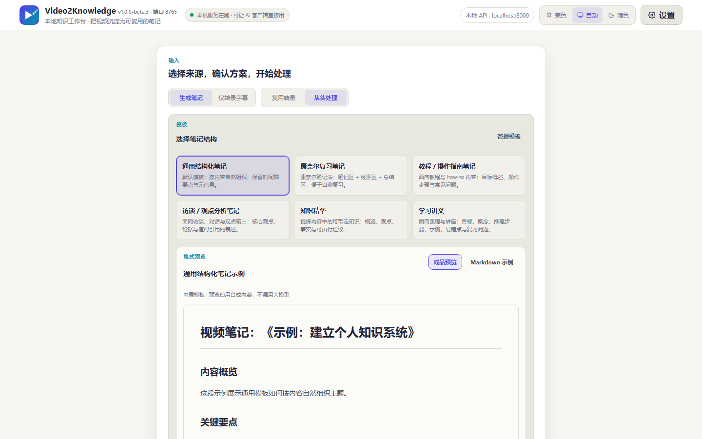
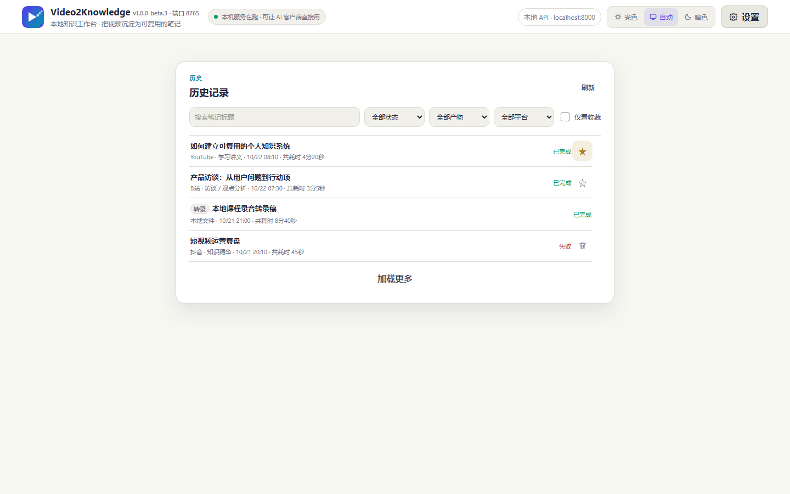
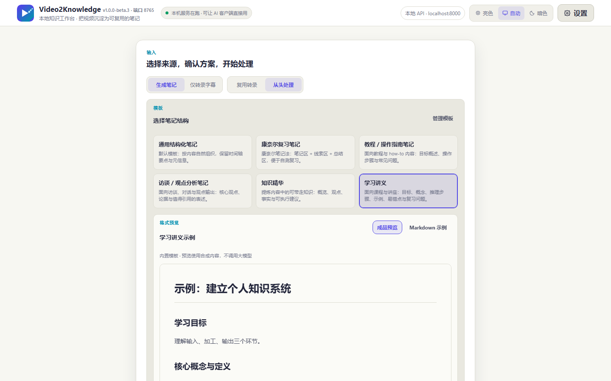

<p align="center">
  
</p>

<h1 align="center">Video2Knowledge v1.0.0-beta.3</h1>

<p align="center"><em>A local knowledge studio: turn videos into Markdown notes you can revisit</em></p>

<p align="center">🌐 <a href="README.md">简体中文</a> · <a href="README_EN.md">English</a></p>

> **Derivation notice**: Video2Knowledge is derived from [VideoToNo](https://github.com/like-attract/video-to-note) `v1.4.2` and keeps the original MIT License and author attribution. See [UPSTREAM.md](UPSTREAM.md) for the upstream baseline, planned customization directions, and attribution rules.

Project documents: [Product baseline](PRD.md) · [Current status](PROJECT_STATUS.md) · [Current tasks](TODO.md) · [Decisions](DECISIONS.md) · [UI design baseline](DESIGN.md) · [Development rules](AGENTS.md)

<p align="center"><span style="white-space: nowrap;"><a href="https://github.com/Eternal-HAC/Video2Knowledge-next/releases"></a>&nbsp;<a href="LICENSE"></a>&nbsp;&nbsp;&nbsp;</span></p>

<p align="center"><a href="https://github.com/Eternal-HAC/Video2Knowledge-next/releases/tag/v1.0.0-beta.3"><strong>⬇️ Download the Windows portable build (v1.0.0-beta.3)</strong></a></p>

## Product positioning

Video2Knowledge is a **local-first knowledge studio**: give it a Bilibili, Douyin, YouTube link or a local media file; it prefers platform captions (including Bilibili AI captions), falls back to on-device transcription when none exist (paraformer is the fast default for Chinese, the Whisper family stays available), then has your chosen LLM write timestamped Markdown notes — or stops at a timestamped transcript without calling any LLM.

It is neither a video downloader nor a general AI console: every download, transcription and file write happens on your machine, and the service listens on `127.0.0.1` by default. Templates, destinations, sources and output type are visible in the main workflow; lower-frequency model and integration settings live in a slide-out panel. The UI and brand design baseline is documented in [DESIGN.md](DESIGN.md).

> 🤖 **Agent Skill**: copy the `skills/video-to-note/` directory from this repo into your agent's skills directory (e.g. `~/.agents/skills/`) and coding agents like Claude Code or pi can generate video notes from a single sentence. See `SKILL.md` inside that directory.

## 🖼️ Knowledge Studio UI

These screenshots are generated from the real page by `scripts/capture_readme_screenshots.mjs` with an isolated workspace and synthetic data. They contain no real credentials, private paths, or user task titles.

### Studio home

<p align="center"></p>

### Local history and favorites

<p align="center"></p>

### Note-template preview

<p align="center"></p>

## ✨ Highlights

- 🎥 **Flexible inputs**: Bilibili, Douyin, YouTube, other URLs supported by the installed `yt-dlp`, and local audio/video files; `.srt` / `.vtt` subtitle files can be imported directly as an already-timed transcript.
- 🇨🇳 **Bilibili integration**: fetches Bilibili AI captions after sign-in, with QR-code credential import in the UI; falls back to the open API when the video page is risk-controlled.
- 🎵 **Douyin single-link integration**: handles public share links directly and can retry after manual verification in an isolated local browser.
- 🧾 **Real timestamps**: keeps segment start and end times from captions or Whisper instead of asking the model to invent them; any transcript exports as a standard SubRip `.srt`.
- 🧠 **Long-transcript handling**: chunks, merges and reduces long material while keeping context pressure under control, and checks that the note reaches the end of the material.
- 📝 **Templates and destinations**: six read-only built-in templates and saved custom templates are selectable in the main workflow. Local Markdown always lands in the default folder, a custom directory, or an Obsidian Vault; Feishu is an optional additional publication.
- 👁️ **No-cost template previews**: selecting a template shows a rendered result and Markdown sample made from fixed synthetic content; previews never call an LLM or read an existing note.
- 🗂️ **Local history and favorites**: search and filter all local task manifests, load them in pages, and star completed notes locally. Older Markdown bodies are read only when opened.
- 🔎 **Platform and reuse guidance**: a pasted URL is classified locally; when a reusable transcript exists, the UI offers explicit open, reuse, or restart actions without automatic submission.
- 🖼️ **Discoverable exports**: the result panel leads with Export Markdown and visibly offers SRT, HTML, JSON, plain text, and PNG, with optional video screenshots as note attachments.
- 🤖 **Raw material for agents**: a connected agent can stop at the timestamped transcript — no LLM call and no API key for this machine, and it writes the notes in its own structure and style.
- 🛡️ **Local-first**: media downloads, transcription, and file generation happen locally; the service listens on `127.0.0.1` by default.

## 🚀 Install (Windows portable build)

> **Release status**: `v1.0.0-beta.3` focuses on template previews, local history/favorites, platform labels, and transcript-reuse guidance. Treat the GitHub Pre-release linked below and its checksum file as the authoritative downloadable assets. See [PROJECT_STATUS.md](PROJECT_STATUS.md) for acceptance evidence.

No Python or development setup is required: download `Video2Knowledge-1.0.0-beta.3-portable.exe` from the [Release page](https://github.com/Eternal-HAC/Video2Knowledge-next/releases/tag/v1.0.0-beta.3):

1. Download and double-click the exe;
2. Wait for the local page to open in your browser;
3. Paste a video URL or upload a local file — for a finished note, enter a provider, model, and API key first; **for a timestamped transcript only, choose "Transcript only" and enter nothing**;
4. Generate and review the note or the transcript.

The portable build starts the local service and stays in the system tray. The first local transcription downloads a model, so keep the network available. Tasks, transcripts, screenshots, and notes are stored under `workspace/` next to the exe by default. Release assets ship with a `SHA256SUMS.txt` for verification.

## ⚙️ Use

After starting the app:

1. Choose **Note** (needs an API key) or **Transcript only** (no LLM call and **no API key**; note templates and note destinations collapse automatically);
2. For a note, choose one of the six built-in templates or a saved custom template in the main workflow, then inspect the rendered or Markdown example below it;
3. Choose the default Markdown folder, a custom directory, or an Obsidian Vault. Enable Feishu only as an additional publication; local Markdown is always retained;
4. In Settings, choose the model profile, note style, transcription options, and API key;
5. Paste a video URL or upload a local / subtitle file. URL classification happens locally, and an existing transcript produces explicit open, reuse, and restart choices;
6. Preview and copy the result, use the explicit **Export Markdown** action, or choose SRT, HTML, JSON, plain text, or PNG under **More export formats**. Web tasks stay available in searchable, paginated local history, and completed notes can be starred locally.

## 🔁 Processing pipeline

```text
Video URL / local file / subtitle file
        ↓
Platform captions (Bilibili AI captions first)
        ↓ when unavailable
Local ASR transcription (paraformer / faster-whisper)
        ↓
Timestamped transcript ──────→ handed to an agent to write its own notes (no LLM, no API key)
        ↓
LLM-generated timestamped Markdown note → chosen directory / Obsidian Vault / optional Feishu doc
```

## 🌍 Supported inputs and compatibility boundaries

- **Focused support**: Bilibili, Douyin, YouTube, and local media use the subtitle-first, local-ASR-fallback pipeline, with targeted regression tests and actionable errors.
- **Generic compatibility**: TikTok, Xiaohongshu, and other `http` / `https` video URLs the installed `yt-dlp` can parse are handled on a best-effort basis, without platform-specific guarantees. The beta.3 badge is offline URL classification, not a live availability check.
- **Pending adaptation**: platforms without dedicated adaptation (such as iQiyi or Tencent Video) depend on access permissions, caption availability, and `yt-dlp` behavior.
- The project does not bypass payment, login, verification, membership, or region restrictions; platform interface changes can temporarily break parsing.

Local `.mp3`, `.m4a`, `.wav`, `.flac`, `.aac`, `.mp4`, `.mkv`, `.mov`, `.webm`, `.avi` media and `.srt` / `.vtt` subtitle files (UTF-8, BOM-tolerant, 20 MB default limit) are accepted as inputs.

## 🧬 Relationship to upstream VideoToNo

- This repository is **derived from VideoToNo `v1.4.2`** (baseline commit and upstream repository in [UPSTREAM.md](UPSTREAM.md)); it preserves the upstream Git history, [MIT License](LICENSE), and author attribution.
- Video downloading, platform caption retrieval, local ASR (faster-whisper / paraformer), and task management **reuse upstream's mature implementations** — this project did not, and does not claim to, reimplement those capabilities from scratch. Successor differences concentrate on product positioning, the interface, note templates, output destinations, and release branding.
- **Version line**: from `v1.0.0-beta.1` on, Video2Knowledge uses an independent version line (beta → rc → stable); the transitional `v1.4.2-v2k.N` numbers always sort before the independent line in update checks.
- **Compatibility boundaries**: the product and UI are renamed to Video2Knowledge, while these protocol positions stay compatible —
  - `/api/health` keeps returning the legacy service id `service: "VideoToNo"` (alongside `product: "Video2Knowledge"` and `api_compat: 1`), so existing launcher, MCP client and Agent Skill discovery keeps working;
  - environment variables prefer the new `VIDEO2KNOWLEDGE_*` names while legacy `VIDEOTONOTES_*` names keep working (e.g. `VIDEO2KNOWLEDGE_WORKSPACE`, `VIDEO2KNOWLEDGE_BACKEND_URL`);
  - non-sensitive browser preferences move to `v2k_prefs`; the first launch copies them from legacy `vtn_prefs` while retaining the old key for rollback, and API keys never enter localStorage; the `workspace/` directory layout is unchanged.

## ⚙️ Advanced use and configuration

Course platforms such as Xiaoe-tech are used through local import: when the platform officially permits download or export, obtain the media file first, then upload it through "Local file" to reuse transcription, templates, Markdown, Obsidian, and the optional Feishu flow. No Xiaoe-tech URL downloader is provided and no payment, login, or content protection is bypassed; without an officially permitted way to obtain the file, extraction is not supported.

Subtitle import: switch the source to "Subtitle file" to upload `.srt` / `.vtt` (default 20 MB per file, surfaced as `max_subtitle_mb` by `/api/health`). The file is parsed into a timestamped transcript on upload and then goes straight to note generation or stays a transcript — no download, audio extraction, or ASR; files without readable timecodes are rejected on the spot without leaving half a task. Imported files are stored as `subtitle.<ext>` and never mix with local media.

For any task with a timestamped transcript, the download menu offers "Subtitles (.srt)": standard SubRip with `HH:MM:SS,mmm` timecodes, CRLF line endings, one cue per segment, rendered by the backend from the persisted segments.

"Failed-task media retention" defaults to forever, with optional 1, 7, or 30 days. A finite choice counts from the failed/cancelled task's finish time; after saving it, the page attempts one cleanup the next time it connects to the local backend, and a "Clean now" button is available. Only expired tasks' known media and download sidecars are removed; notes, transcripts, manifests, screenshots, and unknown files are preserved; active tasks and media being reused are skipped. Unreliable timestamps, linked files, and files that cannot be deleted safely are kept. A retry after cleanup may need a fresh upload or download. The setting lives only in the local browser; there is no scheduled background cleanup.

Age-based deletion currently has handle-level identity protection on Windows; other systems conservatively keep the media and return a warning.

"Upload to Feishu" is off by default. When enabled with a Drive folder token or `/drive/folder/` link, a completed note creates one Feishu online document in that folder, inserting referenced screenshots as native inline image blocks. Publication uses only the local `lark-cli` user identity — no automatic login, no bot fallback, no overwriting existing files. Authorize `lark-cli` yourself before first use (minimal scopes: `docx:document:create`, `docx:document:write_only`, `docs:document.media:upload`; accounts with the wide `docx:document` scope also work). Only images referenced by the note body, inside the task's screenshot directory, and within format/size limits are uploaded. A failed Feishu publication does not affect the local note and can be retried from the result area; on uncertain outcomes such as timeouts the UI warns about possible duplicate documents.

Profiles, recognition settings and the theme are non-sensitive and are remembered automatically in your local browser. An API key stays in the current page only and is lost on refresh until you press **Save to this machine**; that writes it to `workspace/llm_keys.json`, encrypted with Windows' built-in DPAPI (a copy of the file on another machine or Windows account cannot be decrypted) — other platforms store it in plaintext and the interface says so. **A saved key is bound to its endpoint address**: it is only reused when the target address matches, never sent to another gateway. QR-login Bilibili cookies live only in the local process unless you explicitly save them; do not share those workspace files.

<details>
<summary>🧑‍💻 Source use and building (developers)</summary>

For source use, `git clone` or GitHub **Code → Download ZIP** gives you the complete project. The project targets Windows + Python 3.11; install `backend/requirements.txt` and use `start.ps1`:

```powershell
git clone https://github.com/Eternal-HAC/Video2Knowledge-next.git
cd Video2Knowledge-next
.\.venv\Scripts\python.exe -m pip install -r backend\requirements.txt
.\start.ps1
```

Build a Windows portable executable with:

```powershell
powershell -ExecutionPolicy Bypass -File scripts\build_exe.ps1
```

</details>

<details>
<summary>🤖 MCP / AI clients (advanced)</summary>

Video2Knowledge includes an MCP (Model Context Protocol) server, so AI clients such as Cherry Studio and Codex can turn a video link into a timestamped transcript or a note directly. **Start Video2Knowledge first**: MCP tasks run through the local backend and reuse its Whisper model cache and task directories.

Pick a route: if your client already has a capable model, use `transcribe_video` + `get_transcript` to take the timestamped transcript only — **no API key for this machine**, and the client decides the note structure and style. Reach for `summarize_video` when a finished note is wanted in one shot (or for a long video best processed in the background).

The recommended pattern is **get the transcript first, let the client do the organising**: this service only supplies the text, so reading order, judgement, and the final structure are up to the model on your side and your follow-up instructions can stay loose:

```text
Transcribe this video into timestamped text first: https://www.bilibili.com/video/BV1xx
Then organise it as you see fit: go deep on the XXX part, merge what repeats,
fill in the skipped derivations, add background where the video was thin,
and give me something readable at the end.
```

Re-structuring, digging into a single section, or asking follow-up questions while it writes all work, and none of it needs a key on this machine or applies a fixed note template. Use `summarize_video` when you want a ready-made standard note instead (it needs a key and follows the selected style).

Available tools:

| Tool | Description |
|---|---|
| `summarize_video` | Submit a video summarization task; URL, API key, model, and Bilibili credentials can be omitted when saved local config is available for that endpoint |
| `transcribe_video` | Stop at the timestamped transcript: no LLM call anywhere in this route, so no API key is needed |
| `get_transcript` | Fetch a task's transcript (full markdown or JSON segments); works for historical tasks whose note generation later failed |
| `wait_for_task` | Wait for a terminal task state for up to 45 seconds per call — use it instead of aggressive polling. Note tasks return the finished note; transcript-only tasks return status plus a pointer to `get_transcript` |
| `get_task_status` | Inspect intermediate task progress |
| `list_whisper_models` | Show local Whisper model cache status |
| `save_llm_config` | Save the provider, model, and API key for one endpoint address locally (encrypted on Windows, plaintext with a visible note elsewhere) so calls to that address need no key |
| `save_bilibili_credentials` | Save Bilibili credentials such as SESSDATA for automatic use with Bilibili videos, sealed with the same local encryption as API keys (encrypted on Windows, plaintext with a visible note elsewhere) |
| `list_llm_keys` | List the endpoint addresses whose keys are saved locally (masked values and storage algorithm only) |
| `get_saved_config` | View saved configuration status with secrets masked |

### Cherry Studio (recommended; no local Python needed)

1. Start Video2Knowledge, then open Cherry Studio **Settings → MCP Servers → Add**;
2. Choose **Server-Sent Events (SSE)** and enter:

```text
http://127.0.0.1:8000/mcp/sse
```

Use the actual port if it is not 8000. Save and enable the server, then ask the AI client to use the local service.

For first-time use, let the AI call `save_llm_config` and `save_bilibili_credentials` once each (hand keys and credentials to the tools as prompted; never leave plaintext keys in conversations or documents). Afterward, simply ask for what you need:

```text
Summarize this Bilibili video: https://www.bilibili.com/video/BV1xx
```

```text
Just give me a timestamped transcript of this video, I'll write my own notes: https://www.bilibili.com/video/BV1xx
```

The second phrasing sends the client down `transcribe_video` + `get_transcript`, which needs no API key saved on this machine.

### Codex CLI

For stdio clients such as Codex:

```bash
codex mcp add local video2knowledge -- python -m backend.mcp_server
```

The MCP server automatically scans ports 8000–8019 to locate a running Video2Knowledge service (both the new and legacy identities are recognized). Set `VIDEO2KNOWLEDGE_BACKEND_URL` to explicitly choose the backend URL (the legacy name `VIDEOTONOTES_BACKEND_URL` keeps working).

> Privacy: `save_llm_config` (and the web page's **Save to this machine**) writes API keys to `workspace/llm_keys.json`, encrypted per Windows user with the system DPAPI — copying that file to another machine or another Windows account makes it undecryptable and you must re-enter the key. Non-Windows platforms have no DPAPI, so keys are stored in plaintext and the interface says so. A stored key is bound to the endpoint address it was saved for and is only reused when that address matches. `save_bilibili_credentials` seals SESSDATA and bili_jct with the same envelope into `workspace/bili_credentials.json` (also bound to the current Windows account, so re-save it after moving machines; `buvid3` is a device identifier the client already sends in the clear, so it stays plaintext). Nothing is persisted unless you explicitly call a save tool; `workspace/` is excluded by `.gitignore` and is not committed to this repository — do not share those files.

</details>

<details>
<summary>🧩 Agent Skill (advanced)</summary>

Besides MCP, Video2Knowledge also ships an **Agent Skill** (`skills/video-to-note/`) for skill-capable coding agents such as Claude Code and pi: the agent reads `SKILL.md`, then drives the bundled script through the full flow — submit a task, stream progress, and fetch the finished note. **Start Video2Knowledge first**; like MCP, tasks run through the local backend.

### Install

Copy the whole `skills/video-to-note/` directory from this repo into your agent's skills directory, for example:

```text
~/.agents/skills/video-to-note/        # pi / common convention
~/.claude/skills/video-to-note/        # Claude Code
```

### Usage

After installing, just ask in one sentence:

```text
Turn this Bilibili video into notes: https://www.bilibili.com/video/BV1xx
```

```text
Transcribe this video with timestamps, then organise it as you see fit:
go deep on XXX, merge what repeats, add background the video skipped,
and save the result as notes.md: https://www.bilibili.com/video/BV1xx
```

The agent invokes the bundled `scripts/video_note.py`, which auto-detects the service port, submits the task, streams runtime logs, and prints (or saves) the result. The second phrasing takes the `--transcript-only` route: no API key on this machine, and everything after the transcript — judgement, additions, structure — is the agent's call, so the instruction does not need to be precise. Common options: `--transcript-only` (timestamped transcript only, no LLM call), `--style detailed|faithful|concise`, `--wait seconds`, `--out file`; a local video file path works as input too.

> **When the agent has its own model, prefer `--transcript-only`**: that route never calls an LLM, so it needs no API key and the agent keeps full control over note structure and style. Only the finished-note route needs an LLM API key — pass credentials via environment variables as `SKILL.md` describes, never as literal command-line arguments. If this machine has a saved key for exactly one endpoint address (web page **Save to this machine** or the MCP `save_llm_config` tool), omit them and that channel is reused.

</details>

<details>
<summary>❓ FAQ</summary>

### Why does the first transcription take so long?

Local ASR downloads a model the first time that model is used. Download time depends on model size and network conditions. The local cache is reused later, but choosing another model can trigger another download.

Models are cached under `workspace/_model_cache/` by default. Set `WHISPER_CACHE_DIR` in `.env` to use another disk. Downloads use the **hf-mirror.com mirror** by default with resume and retry support; set `HF_ENDPOINT` to switch sources, for example `HF_ENDPOINT=https://huggingface.co` for the official host. If downloads still fail, check network connectivity, proxy settings, and write access to the cache directory.

The app disables Hugging Face's Xet download backend by default and uses regular HTTP downloads to avoid CAS reconstruction failures on some Windows networks. If the selected model is incomplete but a usable `base` model is already cached, the job falls back to `base` and records that decision in the task log rather than waiting indefinitely for a weight download.

### What if large models (medium and above) keep failing to download?

Large models are big (medium ≈ 1.5 GB) and prone to interruptions on unstable networks. Besides retrying (resume supported), you can import a model manually:

1. Pick the model under the transcription settings and click "**Import model manually**". A dialog lists exactly which files that model needs and where to download them; confirm and the app opens the import folder (`workspace/_model_cache/manual/<model>/`);
2. Save those files in a browser: `config.json`, `model.bin`, `tokenizer.json`, plus the vocabulary file — `vocabulary.txt` or `vocabulary.json` depending on the repository; download whichever one the page offers;
3. Drop the files into that folder unchanged. The app detects them within seconds and marks the model as cached.

Downloads and cached files are verified for integrity; corrupt leftovers from interrupted downloads are cleaned up and re-downloaded automatically.

### Why is CPU transcription slower than the video duration?

Speed depends on CPU performance, media duration, and model size. CPU mode uses `int8` to reduce resource pressure, but `medium`, `large-v3`, and `turbo` can still be slow and memory-intensive. Start with `base` on a personal computer, and enable GPU mode only after confirming CUDA works correctly.

### Why would I need a Bilibili cookie?

Publicly accessible videos normally do not need one. Some visible Chinese AI captions are returned only by signed-in caption endpoints; without credentials, the app records the reason and falls back to local ASR. Signed-in, restricted, or caption-limited videos may need credentials for an account that already has access. A cookie cannot grant permissions the account does not have, can expire, and may stop working when the platform changes its rules.

### What happens to tasks after restarting the service?

Video2Knowledge queries complete local history from `workspace/<task-id>/task.json` while preloading only the newest batch; an older note body is read only when that item is opened. Completed tasks remain available for preview and download, and uploaded tasks that have not started can be submitted again. A task that was running during restart is marked failed because external downloads, ASR, and LLM requests cannot continue across processes; already generated captions, transcripts, and audio can still be reused on a later submission.

### Why can a particular URL not be processed?

First confirm that it plays in the current network and account, then update the project's `yt-dlp` dependency. Paid content, DRM, CAPTCHAs, region restrictions, expired signatures, and platform API changes can all prevent extraction. This project does not bypass platform access controls.

### What happens when no captions are available?

The app downloads the best available audio stream and runs local ASR on the machine. This takes longer than using captions and is affected by audio quality, accents, background noise, and domain-specific vocabulary.

### Why does the log say that the model returned no body and reasoning was disabled for a retry?

That message means the model actually returned an empty body; it is not merely a display issue. The app reports it immediately at the current generation stage and retries once with reasoning disabled. If the retry is also empty, the task follows its actual error path.

### Why does the task keep going when the Bilibili video page is unreachable?

In some networks the Bilibili video page is risk-controlled (`HTTP 412`) while the `api.bilibili.com` open endpoints still work. The app automatically falls back to those endpoints for metadata, audio and preview streams (multi-part videos included) and writes "fell back to the open API" into the run log, so you do not need to resubmit. Nothing here bypasses platform permissions: sign-in-only and VIP content still needs valid credentials.

### Why does progress sit on "deep thinking" for a while?

Detailed and Faithful notes default to a higher thinking level, so long videos can spend several minutes producing reasoning only. The UI refreshes "deep thinking (N characters so far)" or "model produced N characters" every 20 seconds, which means the task is still moving. Pick a lower level explicitly under Reasoning effort if you prefer speed or cost. Tasks can be cancelled at any time and transcripts are kept.

### What about a 400 `unsupported_parameter` for `thinking` / `reasoning_effort`?

OpenAI-compatible channels differ a lot in how thinking is controlled: many only accept the standard `reasoning_effort` and reject the vendor-specific `thinking` field with a 400. The app **sends standard parameters by default** (the private `thinking` field is only used to disable thinking on the official DeepSeek API) and degrades automatically when a channel rejects a parameter: `reasoning_effort` → nested `reasoning.effort` → no parameter at all (model default), logging "this channel does not support the X parameter". The same applies to the output budget: if the `max_tokens` raised for the thinking chain exceeds your gateway's cap, it falls back to the note length and finally omits the parameter. To skip the first doomed request, declare the capability up front via an environment variable (comma-separated; `thinking`, `reasoning_effort`, `reasoning`, `enable_thinking`):

```powershell
$env:VIDEO2KNOWLEDGE_REJECTED_LLM_PARAMS = "thinking,reasoning_effort"
```

The legacy name `VIDEOTONOTES_REJECTED_LLM_PARAMS` keeps working; when both are set, the new name wins.

</details>

## 📄 License

Video2Knowledge is derived from VideoToNo and released under the [MIT License](LICENSE), preserving the upstream copyright notice; attribution details are in [UPSTREAM.md](UPSTREAM.md).
